# RC Soar Score Entity Relationship Diagram

ERD for the 30 conceptual entities. Physical design: PostgreSQL backend with IndexedDB clients, UUIDv7 identifiers, composite unique constraints on natural business keys.

```mermaid
erDiagram
    %% Accounts and Ownership
    ACCOUNT {
        uuid accountId "PK"
        text firstName
        text lastName
        text email
        text providerSubject
    }

    %% Contest
    CONTEST {
        uuid contestId "PK"
        text name
        timestamp startDateTime
        timestamp endDateTime
        text timezone
        text host
        text city
        text state
        text country
        uuid ownerAccountId "FK optional"
        text lifecycleState
        text scoringAccess
        text adminLock
        text publicationStatus
        text visibility
        text deletionStatus
        bool localArchive
        int revision
    }

    %% Participants
    PARTICIPANT_PROFILE {
        uuid profileId "PK"
        text firstName
        text lastName
        text club
        text faiNumber
        text nationalOrgId
        text city
        text state
        text country
        text email
        bool isShared
        int revision
    }

    PARTICIPANT_ACCOUNT_LINK {
        uuid linkId "PK"
        uuid profileId "FK"
        uuid accountId "FK"
        int revision
    }

    CONTEST_PARTICIPATION {
        uuid linkId "PK"
        uuid contestId "FK"
        uuid profileId "FK"
        string cls
        uuid roleId "FK"
        text roleType
        int participantNumber
        uuid teamLinkRef "FK optional"
        uuid contestModelLinkRef "FK optional"
        uuid scoringUuid
        int revision
    }

    %% Teams, Roles, Models
    ROLE {
        uuid roleId "PK"
        text displayName
        text type
        text scope
        text permission
        int revision
    }

    TEAM {
        uuid teamId "PK"
        uuid contestId "FK"
        text name
        int pilotTotals
        int revision
    }

    TEAM_MEMBERSHIP {
        uuid membershipId "PK"
        uuid teamId "FK"
        uuid linkId "FK"
        text role
        int revision
    }

    MODEL_CATALOG {
        uuid catalogId "PK"
        text name
        text manufacturer
        int revision
    }

    CONTEST_MODEL_LINK {
        uuid linkId "PK"
        uuid contestId "FK"
        uuid linkId_part "FK"
        uuid catalogId "FK optional"
        text modelName
        text manufacturer
        text modelId
        int revision
    }

    %% Discipline / Config
    DISCIPLINE_PROFILE {
        uuid profileId "PK"
        text type
        int version
        string config
    }

    LANDING_TABLE {
        uuid tableId "PK"
        text name
        int revision
        string config
    }

    LANDING_RESULT {
        uuid resultId "PK"
        int pointValue
        string displayValue
        int points
        string note
        uuid tableId "FK"
    }

    ROUND_CONFIG {
        uuid configId "PK"
        uuid contestId "FK"
        text mode
        int groupsPerRound
        int groupSize
        int revision
    }

    CONTEST_CONFIGURATION_REVISION {
        uuid revisionId "PK"
        uuid contestId "FK"
        uuid disciplineProfileId "FK"
        text configVersion
        text groupScoreMode
        text droppedRoundsMode
        string overrides
        int revision
    }

    %% Matrix / Assignments
    MATRIX_REVISION {
        uuid revisionId "PK"
        uuid contestId "FK"
        string config
        uuid seed
        text fairnessResult
        uuid creatorId
        text reason
        text finalizingAgent
        bool finalized
        int revision
    }

    MATRIX_ASSIGNMENT {
        uuid assignmentId "PK"
        uuid matrixRevisionId "FK"
        uuid linkId_part "FK"
        int scheduledRound
        int creditedRound
        int group
        int lane
        text assignmentType
        uuid sourceAssignmentId "FK optional"
        text flightSequence
        int assignmentRevision
        int revision
    }

    RE_FLIGHT {
        uuid reflightId "PK"
        uuid contestId "FK"
        uuid creditedRound
        string type
        int sequence
        string lifecycleStatus
        string reasons
        string awards
        string selectedPilots
        string exclusion
        string responses
        string notifications
        string directorDecision
        int revision
    }

    %% Scores and Results
    SCORE_PLACEHOLDER {
        uuid placeholderId "PK"
        uuid assignmentId "FK"
        uuid linkId_part "FK"
        int scheduledRound
        int creditedRound
        int group
        int flightSequence
        text state
        int scoreRevision
        int revision
    }

    SCORE_ATTEMPT {
        uuid attemptId "PK"
        uuid placeholderId "FK"
        string rawComponents
        int cumulativePenalty
        text zeroReason
        string deductions
        uuid actorId
        text authority
        uuid invitationReference
        string sourceDevice
        string clientMutationId
        timestamp acceptanceTime
        int baseScoreRevision
        int revision
    }

    OFFICIAL_SCORE {
        uuid officialScoreId "PK"
        uuid placeholderId "FK"
        int scoreRevision
        string components
        timestamp setAt
        int revision
    }

    SCORE_CALCULATION_RESULT {
        uuid resultId "PK"
        uuid calculatedFromRevision "FK"
        int rawFlightScore
        int normalizedGroupScore
        int contestTotal
        bool droppedRound
        int rank
        int teamTotal
        string calculationStage
        int revision
    }

    %% Publication
    PUBLICATION_IDENTITY {
        uuid publicationId "PK"
        uuid contestId "FK"
        text owner
        text claim_status
        text visibility
        int revision
    }

    PUBLICATION_PROJECTION {
        uuid projectionId "PK"
        uuid publicationId "FK"
        int sourceRevision
        string content
        timestamp publishedAt
        text result
        int projectionRevision
        int revision
    }

    %% Synchronization and Audit
    SYNC_CURSOR {
        uuid cursorId "PK"
        uuid contestId "FK"
        int lastSyncedSeq
        timestamp updatedAt
    }

    MUTATION_RECORD {
        uuid mutationId "PK"
        uuid entity_id
        uuid contestId "FK"
        text entityType
        int baseRevision
        string clientMutationId
        uuid actor
        text authority
        string sourceInstallation
        timestamp clientTime
        timestamp serverTime
        text outcome
        int revision
    }

    CONFLICT_RECORD {
        uuid conflictId "PK"
        uuid entity_id
        uuid winnerMutationId "FK"
        uuid loserMutationId "FK"
        text reason
        text resolution
    }

    TOMBSTONE {
        uuid tombstoneId "PK"
        uuid entity_id
        uuid contestId "FK"
        text status
        string deletionReason
    }

    INVITATION {
        uuid invitationId "PK"
        uuid contestId "FK"
        uuid linkId_part "FK"
        string type
        string protectedCred
        int invitationRevision
        text state
        text audience
        timestamp issuedAt
        timestamp usedAt
        timestamp expiredAt
        timestamp revokedAt
    }

    REVIEW_REQUEST {
        uuid reviewId "PK"
        uuid placeholderId "FK"
        string proposedComponents
        int proposedCumulativePenalty
        string participantMessage
        uuid requester
        int baseScoreRevision
        timestamp requestTime
        text state
        uuid decisionActor
        timestamp decisionTime
        string decisionMessage
    }

    AUDIT_EVENT {
        uuid auditEventId "PK"
        uuid contestId "FK"
        text entityType
        uuid entityId
        text action
        uuid actor
        text authority
        string installation
        int baseRevision
        int resultingRevision
        timestamp server
        timestamp client
        text reason
        text outcome
    }

    %% Relationships

    ACCOUNT ||--o{ CONTEST : "owns (optional)"
    ACCOUNT }o--o{ PARTICIPANT_ACCOUNT_LINK : "linked to"
    PARTICIPANT_PROFILE }o--o{ PARTICIPANT_ACCOUNT_LINK : "linked to"
    PARTICIPANT_ACCOUNT_LINK }o--o{ PARTICIPANT_PROFILE : "-1"

    CONTEST ||--o{ CONTEST_CONFIGURATION_REVISION : "has revisions"
    CONTEST ||--o{ MATRIX_REVISION : "has revisions"
    CONTEST ||--o{ SYNC_CURSOR : "has cursor"
    CONTEST ||--o{ ROUND_CONFIG : "has"
    CONTEST ||--o{ TEAM : "has teams"
    CONTEST ||--o{ CONTEST_PARTICIPATION : "has participations"
    CONTEST ||--o{ CONTEST_MODEL_LINK : "has links"
    CONTEST ||--o{ RE_FLIGHT : "has"
    CONTEST ||--o{ INVITATION : "has"
    CONTEST ||--o{ AUDIT_EVENT : "has events"
    CONTEST ||--o{ SCORE_PLACEHOLDER : "indirect ownership via assignment"
    CONTEST ||--o{ MUTATION_RECORD : "has"
    CONTEST ||--o{ CONFLICT_RECORD : "has"
    CONTEST ||--o{ TOMBSTONE : "has"
    CONTEST ||--o{ SCORE_ATTEMPT : "indirect ownership via placeholder"
    CONTEST ||--o{ OFFICIAL_SCORE : "indirect ownership via placeholder"
    CONTEST ||--o{ SCORE_CALCULATION_RESULT : "indirect ownership"
    CONTEST ||--o{ PUBLICATION_IDENTITY : "has"
    CONTEST ||--o{ REVIEW_REQUEST : "indirect ownership"

    PARTICIPANT_PROFILE ||--o{ CONTEST_PARTICIPATION : "profile for"
    PARTICIPANT_PROFILE }o--o{ CONTEST_PARTICIPATION : "profile for"
    PARTICIPANT_PROFILE ||--o{ CONTEST_MODEL_LINK : "model snapshot"
    PARTICIPANT_PROFILE }o--o{ CONTEST_MODEL_LINK : "model snapshot"

    CONTEST_PARTICIPATION ||--o{ MATRIX_ASSIGNMENT : "assignment belongs to this participation"
    CONTEST_PARTICIPATION }o--o{ MATRIX_ASSIGNMENT : "assignment belongs to this participation"
    CONTEST_PARTICIPATION }o--o{ SCORE_PLACEHOLDER : "has placeholders"
    CONTEST_PARTICIPATION }o--o{ REVIEW_REQUEST : "has review requests"
    CONTEST_PARTICIPATION }o--o{ INVITATION : "has invitations"

    MATRIX_REVISION ||--o{ MATRIX_ASSIGNMENT : "contains"
    MATRIX_REVISION }o--o{ MATRIX_ASSIGNMENT : "contains"
    MATRIX_REVISION ||--o{ RE_FLIGHT : "has"
    MATRIX_REVISION }o--o{ RE_FLIGHT : "has"

    CONTEST_CONFIGURATION_REVISION ||--o{ SCORE_ATTEMPT : "cited by"
    CONTEST_CONFIGURATION_REVISION }o--o{ SCORE_ATTEMPT : "cited by"
    MATRIX_REVISION ||--o{ SCORE_ATTEMPT : "cited by"
    MATRIX_REVISION }o--o{ SCORE_ATTEMPT : "cited by"

    DISCIPLINE_PROFILE ||--o{ CONTEST_CONFIGURATION_REVISION : "referenced by"
    DISCIPLINE_PROFILE }o--o{ CONTEST_CONFIGURATION_REVISION : "referenced by"

    LANDING_TABLE ||--o{ CONTEST_CONFIGURATION_REVISION : "used by"
    LANDING_TABLE }o--o{ CONTEST_CONFIGURATION_REVISION : "used by"
    LANDING_TABLE ||--o{ SCORE_ATTEMPT : "used by"
    LANDING_TABLE }o--o{ SCORE_ATTEMPT : "used by"

    SCORE_PLACEHOLDER ||--o{ OFFICIAL_SCORE : "has"
    SCORE_PLACEHOLDER }o--o{ OFFICIAL_SCORE : "has"
    SCORE_PLACEHOLDER ||--o{ SCORE_CALCULATION_RESULT : "has"
    SCORE_PLACEHOLDER }o--o{ SCORE_CALCULATION_RESULT : "has"

    PUBLICATION_IDENTITY ||--o{ PUBLICATION_PROJECTION : "has"
    PUBLICATION_IDENTITY }o--o{ PUBLICATION_PROJECTION : "has"

    CONTEST ||--o{ PUBLICATION_PROJECTION : "projected to"
    CONTEST }o--o{ PUBLICATION_PROJECTION : "projected to"

    TEAM ||--o{ TEAM_MEMBERSHIP : "has members"
    TEAM }o--o{ TEAM_MEMBERSHIP : "has members"
    CONTEST_PARTICIPATION }o--o{ TEAM_MEMBERSHIP : "is member"
    TEAM_MEMBERSHIP }o--o{ CONTEST_PARTICIPATION : "is member"
```

