# RC Soar Score Data Model

Canonical documentation for the Soar Score data model. This folder is the source of truth for all entities, relationships, identifiers, types, and constraints.

## Contents

- [Entity Relationship Diagram (ERD)](ERD.md) - Mermaid diagram of all entities and their relationships
- [Contest Options](contest-options.md) - Every setting a director can make, where it is stored, its defaults, and when it can change
- [Entity Documentation](entities/) - Per-entity specifications (47 files)
- [Reconciliation Findings](reconciliation-findings.md) - Gaps and conflicts between this model and the architecture and business requirements

## Entity Catalog

### Identity, Participants & Access

| Entity                    | File                                                                               | Source Requirement                                                                         | Purpose                                                                                       |
| ------------------------- | ---------------------------------------------------------------------------------- | ------------------------------------------------------------------------------------------ | --------------------------------------------------------------------------------------------- |
| Account                   | [entities/account.md](entities/account.md)                                         | [accounts.md](../architecture-requirements/data/accounts.md)                               | Authenticated user identity                                                                   |
| AccountIdentity           | [entities/account_identity.md](entities/account_identity.md)                       | [accounts.md](../architecture-requirements/data/accounts.md)                               | Identity-provider login (issuer and subject) attached to an account                           |
| AccountPublicProfile      | [entities/account_public_profile.md](entities/account_public_profile.md)           | [accounts.md](../architecture-requirements/data/accounts.md)                               | Public stand-in for an account referenced by publications                                     |
| ParticipantProfile        | [entities/participant_profile.md](entities/participant_profile.md)                 | [participants.md](../architecture-requirements/data/participants.md)                       | Director-owned reusable participant details, never shared with other directors                |
| ParticipantAccountLink    | [entities/participant_account_link.md](entities/participant_account_link.md)       | [participants.md](../architecture-requirements/data/participants.md)                       | Relates a director's profile back to a participant's account (candidate, confirmed, or ended) |
| ParticipantDirectoryEntry | [entities/participant_directory_entry.md](entities/participant_directory_entry.md) | [participants.md](../architecture-requirements/data/participants.md)                       | Basic details a person offers to directors, copied into a director's own profile              |
| ContestParticipation      | [entities/contest_participation.md](entities/contest_participation.md)             | [participants.md](../architecture-requirements/data/participants.md)                       | Contest-snapshot linking profile to contest with class/role/number                            |
| Invitation                | [entities/invitation.md](entities/invitation.md)                                   | [reviews-and-invitations.md](../architecture-requirements/data/reviews-and-invitations.md) | Participant access token (QR/magic URL)                                                       |

### Teams, Roles & Models

| Entity           | File                                                             | Source Requirement                                                               | Purpose                                                                 |
| ---------------- | ---------------------------------------------------------------- | -------------------------------------------------------------------------------- | ----------------------------------------------------------------------- |
| Role             | [entities/role.md](entities/role.md)                             | [teams-roles-models.md](../architecture-requirements/data/teams-roles-models.md) | Per-participant role (Pilot vs NonFlier) with system and contest scopes |
| Team             | [entities/team.md](entities/team.md)                             | [teams-roles-models.md](../architecture-requirements/data/teams-roles-models.md) | Contest-scoped team with pilot-total configuration                      |
| TeamMembership   | [entities/team_membership.md](entities/team_membership.md)       | [teams-roles-models.md](../architecture-requirements/data/teams-roles-models.md) | Link between team and participation with team role                      |
| ModelCatalog     | [entities/model_catalog.md](entities/model_catalog.md)           | [teams-roles-models.md](../architecture-requirements/data/teams-roles-models.md) | Reusable model name/manufacturer catalog                                |
| ContestModelLink | [entities/contest_model_link.md](entities/contest_model_link.md) | [teams-roles-models.md](../architecture-requirements/data/teams-roles-models.md) | Contest-snapshot link from participation to model                       |

### Contest & Contest Configuration

| Entity                       | File                                                                                     | Source Requirement                                         | Purpose                                                                          |
| ---------------------------- | ---------------------------------------------------------------------------------------- | ---------------------------------------------------------- | -------------------------------------------------------------------------------- |
| Contest                      | [entities/contest.md](entities/contest.md)                                               | [contest.md](../architecture-requirements/data/contest.md) | Private source-of-truth event aggregate root with lifecycle and revisioned state |
| ContestConfigurationRevision | [entities/contest_configuration_revision.md](entities/contest_configuration_revision.md) | [contest.md](../architecture-requirements/data/contest.md) | Revisioned contest-scoped overrides of discipline config                         |
| ContestConfigurationPreset   | [entities/contest_configuration_preset.md](entities/contest_configuration_preset.md)     | [contest.md](../architecture-requirements/data/contest.md) | A director's saved, named set of contest settings to start a new contest from    |

### Disciplines & Landing Tables

| Entity                | File                                                                     | Source Requirement                                                                                     | Purpose                                                                                                          |
| --------------------- | ------------------------------------------------------------------------ | ------------------------------------------------------------------------------------------------------ | ---------------------------------------------------------------------------------------------------------------- |
| DisciplineProfile     | [entities/discipline_profile.md](entities/discipline_profile.md)         | [disciplines-and-configuration.md](../architecture-requirements/data/disciplines-and-configuration.md) | Versioned official scoring profile identity, metadata, and lifecycle per discipline                              |
| DisciplineConfigField | [entities/discipline_configfield.md](entities/discipline_configfield.md) | [disciplines-and-configuration.md](../architecture-requirements/data/disciplines-and-configuration.md) | Contest-scoped configuration field schemas for a discipline variant                                              |
| DisciplineScoreField  | [entities/discipline_scorefield.md](entities/discipline_scorefield.md)   | [disciplines-and-configuration.md](../architecture-requirements/data/disciplines-and-configuration.md) | Score-entry field schemas for a discipline variant                                                               |
| DisciplineValidation  | [entities/discipline_validation.md](entities/discipline_validation.md)   | [disciplines-and-configuration.md](../architecture-requirements/data/disciplines-and-configuration.md) | Cross-field validation constraints between score entry fields for a discipline variant                           |
| DisciplineFormula     | [entities/discipline_formula.md](entities/discipline_formula.md)         | [disciplines-and-configuration.md](../architecture-requirements/data/disciplines-and-configuration.md) | Score and penalty calculation formulas for a discipline variant                                                  |
| DisciplineRule        | [entities/discipline_rule.md](entities/discipline_rule.md)               | [disciplines-and-configuration.md](../architecture-requirements/data/disciplines-and-configuration.md) | Score, penalty, and zero-score rules for a discipline variant (includes display/UX metadata for zero conditions) |
| LandingTable          | [entities/landing_table.md](entities/landing_table.md)                   | [disciplines-and-configuration.md](../architecture-requirements/data/disciplines-and-configuration.md) | Immutable landing bonus table shipped with a profile or created by a director                                    |
| LandingResult         | [entities/landing_result.md](entities/landing_result.md)                 | [disciplines-and-configuration.md](../architecture-requirements/data/disciplines-and-configuration.md) | Selectable entry in a landing table: key, label, and points awarded                                              |

### Matrix, Assignments & Re-flights

| Entity              | File                                                                   | Source Requirement                                                                       | Purpose                                                                                         | Outstanding Issues                                                                                                                                                                                 |
| ------------------- | ---------------------------------------------------------------------- | ---------------------------------------------------------------------------------------- | ----------------------------------------------------------------------------------------------- | -------------------------------------------------------------------------------------------------------------------------------------------------------------------------------------------------- |
| MatrixRevision      | [entities/matrix_revision.md](entities/matrix_revision.md)             | [matrix-and-assignments.md](../architecture-requirements/data/matrix-and-assignments.md) | Revisioned draw configuration and assignment schedule                                           | **YES** - The property `participating_participant_participations` is defining an array of uuid values that map participants to the matrix revision. This should likely be done in a linking table. |
| MatrixAssignment    | [entities/matrix_assignment.md](entities/matrix_assignment.md)         | [matrix-and-assignments.md](../architecture-requirements/data/matrix-and-assignments.md) | Individual assignment from participant to round/group/lane                                      |                                                                                                                                                                                                    |
| ReFlight            | [entities/re_flight.md](entities/re_flight.md)                         | [matrix-and-assignments.md](../architecture-requirements/data/matrix-and-assignments.md) | Extra chance to fly given to pilots for a round: method, group, reason, status, and draw inputs |                                                                                                                                                                                                    |
| ReFlightParticipant | [entities/re_flight_participant.md](entities/re_flight_participant.md) | [matrix-and-assignments.md](../architecture-requirements/data/matrix-and-assignments.md) | A pilot's part in a re-flight: role, draw position, response, and notification                  |                                                                                                                                                                                                    |
| Round               | [entities/round.md](entities/round.md)                                 | [matrix-and-assignments.md](../architecture-requirements/data/matrix-and-assignments.md) | A numbered round of flights within a matrix revision.                                           |                                                                                                                                                                                                    |

### Scores, Results & Reviews

| Entity                | File                                                                     | Source Requirement                                                                         | Purpose                                                                                                     | Outstanding Issues                                                                               |
| --------------------- | ------------------------------------------------------------------------ | ------------------------------------------------------------------------------------------ | ----------------------------------------------------------------------------------------------------------- | ------------------------------------------------------------------------------------------------ |
| ScorePlaceholder      | [entities/score_placeholder.md](entities/score_placeholder.md)           | [scores-and-results.md](../architecture-requirements/data/scores-and-results.md)           | Score state holder for every pilot assignment                                                               | **YES** - Need to re-evaluate it against the architecture and business reqs. Properties look odd |
| ScoreAttempt          | [entities/score_attempt.md](entities/score_attempt.md)                   | [scores-and-results.md](../architecture-requirements/data/scores-and-results.md)           | Immutable canonical raw score submission                                                                    |                                                                                                  |
| OfficialScore         | [entities/official_score.md](entities/official_score.md)                 | [scores-and-results.md](../architecture-requirements/data/scores-and-results.md)           | Authoritative versioned score output                                                                        |                                                                                                  |
| FlightResult          | [entities/flight_result.md](entities/flight_result.md)                   | [scores-and-results.md](../architecture-requirements/data/scores-and-results.md)           | Stored, recomputable result of one flight: raw points, landing points, penalty, and normalized round result |                                                                                                  |
| ParticipationStanding | [entities/participation_standing.md](entities/participation_standing.md) | [scores-and-results.md](../architecture-requirements/data/scores-and-results.md)           | Stored, recomputable overall standing of a pilot as of each completed round                                 |                                                                                                  |
| TeamStanding          | [entities/team_standing.md](entities/team_standing.md)                   | [scores-and-results.md](../architecture-requirements/data/scores-and-results.md)           | Stored, recomputable team standing as of each completed round                                               |                                                                                                  |
| ReviewRequest         | [entities/review_request.md](entities/review_request.md)                 | [reviews-and-invitations.md](../architecture-requirements/data/reviews-and-invitations.md) | Proposed score change for official review                                                                   |                                                                                                  |

### Publication

| Entity                 | File                                                                       | Source Requirement                                                 | Purpose                                                                                    |
| ---------------------- | -------------------------------------------------------------------------- | ------------------------------------------------------------------ | ------------------------------------------------------------------------------------------ |
| PublicationIdentity    | [entities/publication_identity.md](entities/publication_identity.md)       | [publication.md](../architecture-requirements/data/publication.md) | Public identity for published contest                                                      |
| PublicationProjection  | [entities/publication_projection.md](entities/publication_projection.md)   | [publication.md](../architecture-requirements/data/publication.md) | Atomic frozen projection of contest data for publication                                   |
| PublicationParticipant | [entities/publication_participant.md](entities/publication_participant.md) | [publication.md](../architecture-requirements/data/publication.md) | Redactable pilot details shown in a publication, referenced by opaque key                  |
| DelistRequest          | [entities/delist_request.md](entities/delist_request.md)                   | [publication.md](../architecture-requirements/data/publication.md) | Owner request, decided by a system administrator, to remove a publication from public view |

### Synchronization & Audit

| Entity                 | File                                                                       | Source Requirement                                                                             | Purpose                                                                            |
| ---------------------- | -------------------------------------------------------------------------- | ---------------------------------------------------------------------------------------------- | ---------------------------------------------------------------------------------- |
| Installation           | [entities/installation.md](entities/installation.md)                       | [synchronization-and-audit.md](../architecture-requirements/data/synchronization-and-audit.md) | A director's app instance: where changes come from and what it has synchronized    |
| InstallationActivation | [entities/installation_activation.md](entities/installation_activation.md) | [synchronization-and-audit.md](../architecture-requirements/data/synchronization-and-audit.md) | Which installation holds administrative authority over a contest, and for how long |
| SyncCursor             | [entities/sync_cursor.md](entities/sync_cursor.md)                         | [synchronization-and-audit.md](../architecture-requirements/data/synchronization-and-audit.md) | Per-contest monotonic sequence for client sync                                     |
| MutationRecord         | [entities/mutation_record.md](entities/mutation_record.md)                 | [synchronization-and-audit.md](../architecture-requirements/data/synchronization-and-audit.md) | Individual client mutation request/response                                        |
| ConflictRecord         | [entities/conflict_record.md](entities/conflict_record.md)                 | [synchronization-and-audit.md](../architecture-requirements/data/synchronization-and-audit.md) | Conflict between competing mutations                                               |
| Tombstone              | [entities/tombstone.md](entities/tombstone.md)                             | [synchronization-and-audit.md](../architecture-requirements/data/synchronization-and-audit.md) | Soft-deletion marker for sync-safe deletes                                         |
| AuditEvent             | [entities/audit_event.md](entities/audit_event.md)                         | [synchronization-and-audit.md](../architecture-requirements/data/synchronization-and-audit.md) | Immutable audit trail of all contested state changes                               |

## Sync Scope

Which stream carries each entity, and who may write it. Contest data synchronizes through a per-contest sequence. A director's own data synchronizes through a separate per-director sequence. System data only comes down.

| Scope                 | Entities                                                                                                                                                                                                                                                                              | Notes                                                                                                        |
| --------------------- | ------------------------------------------------------------------------------------------------------------------------------------------------------------------------------------------------------------------------------------------------------------------------------------- | ------------------------------------------------------------------------------------------------------------ |
| Contest data          | Contest, ContestConfigurationRevision, ContestParticipation, Team, TeamMembership, ContestModelLink, MatrixRevision, Round, MatrixAssignment, ReFlight, ReFlightParticipant, ScorePlaceholder, ScoreAttempt, OfficialScore, ReviewRequest, MutationRecord, ConflictRecord, AuditEvent | Carries `contest_id` and a revision. Changes go through the contest stream                                   |
| Director data         | ParticipantProfile, ModelCatalog, ContestConfigurationPreset, Role and LandingTable (with their LandingResult rows) when owned by the director, and the tombstones of deleted contests                                                                                                | Carries `owner_account_id`. Changes go through the director stream                                           |
| System data           | DisciplineProfile and its field, validation, formula, and rule rows, system Role, system LandingTable and LandingResult                                                                                                                                                               | Written on the server by administrators and synchronized down only. `Installation.system_data_seq` tracks it |
| Issued by the service | Invitation                                                                                                                                                                                                                                                                            | Created and replaced by the service, read by installations                                                   |
| Derived               | FlightResult, ParticipationStanding, TeamStanding                                                                                                                                                                                                                                     | Written only by the calculator, received read-only, never merged                                             |
| Backend only          | Account, AccountIdentity, AccountPublicProfile, ParticipantAccountLink, ParticipantDirectoryEntry, PublicationIdentity, PublicationProjection, PublicationParticipant, DelistRequest, Installation, InstallationActivation, SyncCursor                                                | Never synchronized to installations                                                                          |

## Relationships

Overview of how the entities relate, grouped as in the catalog above. [ERD.md](ERD.md) is the complete view with every column and foreign key.

```mermaid
graph TD
    subgraph IDP[Identity, Participants and Access]
        A[Account]
        AI[AccountIdentity]
        APP[AccountPublicProfile]
        P[ParticipantProfile]
        PDE[ParticipantDirectoryEntry]
        PAL[ParticipantAccountLink]
        CP[ContestParticipation]
        IT[Invitation]
    end

    subgraph TRM[Teams, Roles and Models]
        R[Role]
        TR[Team]
        TM[TeamMembership]
        MC[ModelCatalog]
        CML[ContestModelLink]
    end

    subgraph CCF[Contest and Configuration]
        C[Contest]
        CPRE[ContestConfigurationPreset]
        CR[ContestConfigurationRevision]
    end

    subgraph DSC[Disciplines and Landing Tables]
        DP[DisciplineProfile]
        DCF[DisciplineConfigField]
        DSF[DisciplineScoreField]
        DV[DisciplineValidation]
        DFL[DisciplineFormula]
        DRL[DisciplineRule]
        LT[LandingTable]
        LR[LandingResult]
    end

    subgraph MTX[Matrix, Assignments and Re-flights]
        M[MatrixRevision]
        RD[Round]
        MA[MatrixAssignment]
        RF[ReFlight]
        RFP[ReFlightParticipant]
    end

    subgraph SCR[Scores, Results and Reviews]
        SP[ScorePlaceholder]
        SA[ScoreAttempt]
        OS[OfficialScore]
        FR[FlightResult]
        PS[ParticipationStanding]
        TS[TeamStanding]
        RR[ReviewRequest]
    end

    subgraph PUB[Publication]
        PI[PublicationIdentity]
        PP[PublicationProjection]
        PPA[PublicationParticipant]
        DR[DelistRequest]
    end

    subgraph SYN[Synchronization and Audit]
        INS[Installation]
        IA[InstallationActivation]
        SC[SyncCursor]
        MR[MutationRecord]
        CF[ConflictRecord]
        T[Tombstone]
        AE[AuditEvent]
    end

    A -->|has| AI
    A -->|has| APP
    A -->|offers| PDE
    A -->|owns director's| P
    A -->|owns| C
    A -->|owns| CPRE
    A -->|linked via| PAL
    P -->|linked via| PAL
    P -->|profile of| CP
    C -->|has| CP
    C -->|has| IT
    CP -->|has| IT
    A -->|issues and redeems| IT

    C -->|has| TR
    TR -->|has| TM
    CP -->|member via| TM
    R -->|assigned to| CP
    A -->|owns| R
    CP -->|enters| CML
    MC -->|catalog source| CML

    C -->|has| CR
    CPRE -->|source preset| CR
    DP -->|selected by| CR
    DP -->|basis of| CPRE
    LT -->|selected by| CR

    DP -->|defines| DCF
    DP -->|defines| DSF
    DP -->|defines| DV
    DP -->|defines| DFL
    DP -->|defines| DRL
    LT -->|default for| DP
    LT -->|contains| LR

    C -->|has| M
    M -->|contains| RD
    M -->|contains| MA
    RD -->|scheduled and credited in| MA
    CP -->|flies| MA
    C -->|has| RF
    RF -->|creates| MA
    RF -->|involves| RFP
    CP -->|takes part as| RFP

    MA -->|scored by| SP
    SP -->|has| SA
    SP -->|has| OS
    SP -->|has| RR
    SA -->|produces| OS
    SP -->|calculated as| FR
    OS -->|computed from| FR
    FR -->|feeds| PS
    CP -->|has| PS
    PS -->|feeds| TS
    TR -->|has| TS
    CR -->|calculated under| FR
    IT -->|submitted under| SA
    CR -->|entered under| SA
    M -->|entered under| SA

    C -->|published as| PI
    PI -->|has| PP
    PI -->|identifies pilots| PPA
    PI -->|subject of| DR
    APP -->|owns| PI
    APP -->|supports results of| PPA
    A -->|requests and decides| DR
    PI -->|audited by| AE

    C -->|has| SC
    C -->|authority history| IA
    A -->|owns| INS
    INS -->|holds authority via| IA
    INS -->|tracked by| SC
    INS -->|submits| MR
    RR -->|resulted in| SA
    C -->|has| MR
    C -->|has| CF
    C -->|has| T
    C -->|has| AE
    MR -->|winner and loser| CF
```

## Architecture Reference

This documentation derives from the canonical architectural requirements in [architecture-requirements/data](../architecture-requirements/data/README.md). When there is a conflict between this documentation and the architectural requirements, the architectural requirements take precedence.

## Physical Design Decisions

Based on the architecture requirements, this data model is implemented as:

- **Storage backend (server):** PostgreSQL relational database
- **Storage backend (clients):** IndexedDB (PWA) or embedded database (desktop)
- **Identifiers:** UUIDv7 (time-ordered, collision-resistant). The one exception is `ContestParticipation.scoring_uuid`, a random UUIDv4, because it must not be sequential
- **Keys:** Surrogate UUIDv7 primary keys with composite unique constraints on natural business keys and idempotency keys
- **Timestamps:** All stored in UTC
- **Strings:** ISO 8601 timestamps stored as strings
- **Enumerated types:** PostgreSQL `ENUM` with explicit name and values
