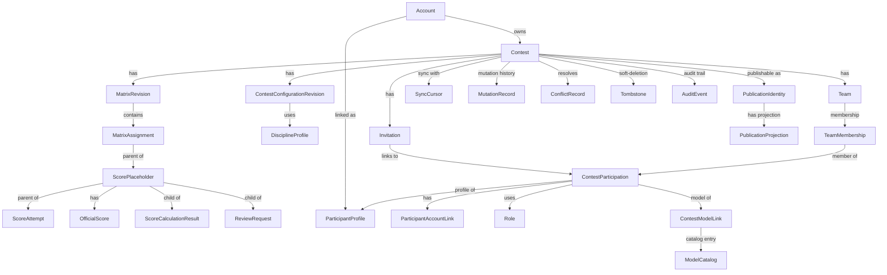

# RC Soar Score Data Model

Canonical documentation for the Soar Score data model. This folder is the source of truth for all entities, relationships, identifiers, types, and constraints.

## Contents

- [Entity Relationship Diagram (ERD)](ERD.md) - Mermaid diagram of all 30 entities and their relationships
- [Entity Documentation](entities/) - Per-entity specifications (30 files)

## Entity Catalog

| Entity | File | Source Requirement | Purpose |
|--------|------|-------------------|---------|
| Account | [entities/account.md](entities/account.md) | [accounts.md](../architecture-requirements/data/accounts.md) | Authenticated user identity |
| Contest | [entities/contest.md](entities/contest.md) | [contest.md](../architecture-requirements/data/contest.md) | Private source-of-truth event aggregate root with lifecycle and revisioned state |
| ParticipantProfile | [entities/participant_profile.md](entities/participant_profile.md) | [participants.md](../architecture-requirements/data/participants.md) | Reusable participant identity data |
| ParticipantAccountLink | [entities/participant_account_link.md](entities/participant_account_link.md) | [participants.md](../architecture-requirements/data/participants.md) | Many-to-many link between participant profiles and user accounts |
| ContestParticipation | [entities/contest_participation.md](entities/contest_participation.md) | [participants.md](../architecture-requirements/data/participants.md) | Contest-snapshot linking profile to contest with class/role/number |
| Role | [entities/role.md](entities/role.md) | [teams-roles-models.md](../architecture-requirements/data/teams-roles-models.md) | Per-participant role (Pilot vs NonFlier) with system and contest scopes |
| Team | [entities/team.md](entities/team.md) | [teams-roles-models.md](../architecture-requirements/data/teams-roles-models.md) | Contest-scoped team with pilot-total configuration |
| TeamMembership | [entities/team_membership.md](entities/team_membership.md) | [teams-roles-models.md](../architecture-requirements/data/teams-roles-models.md) | Link between team and participation with team role |
| ModelCatalog | [entities/model_catalog.md](entities/model_catalog.md) | [teams-roles-models.md](../architecture-requirements/data/teams-roles-models.md) | Reusable model name/manufacturer catalog |
| ContestModelLink | [entities/contest_model_link.md](entities/contest_model_link.md) | [teams-roles-models.md](../architecture-requirements/data/teams-roles-models.md) | Contest-snapshot link from participation to model |
| DisciplineProfile | [entities/discipline_profile.md](entities/discipline_profile.md) | [disciplines-and-configuration.md](../architecture-requirements/data/disciplines-and-configuration.md) | Versioned official scoring profile per discipline |
| LandingTable | [entities/landing_table.md](entities/landing_table.md) | [disciplines-and-configuration.md](../architecture-requirements/data/disciplines-and-configuration.md) | Versioned lookup table (distance → points) |
| RoundConfig | [entities/round_config.md](entities/round_config.md) | [contest.md](../architecture-requirements/data/contest.md) | Contest-scoped round/group/lane setup |
| ContestConfigurationRevision | [entities/contest_configuration_revision.md](entities/contest_configuration_revision.md) | [contest.md](../architecture-requirements/data/contest.md) | Revisioned contest-scoped overrides of discipline config |
| MatrixRevision | [entities/matrix_revision.md](entities/matrix_revision.md) | [matrix-and-assignments.md](../architecture-requirements/data/matrix-and-assignments.md) | Revisioned draw configuration and assignment schedule |
| MatrixAssignment | [entities/matrix_assignment.md](entities/matrix_assignment.md) | [matrix-and-assignments.md](../architecture-requirements/data/matrix-and-assignments.md) | Individual assignment from participant to round/group/lane |
| ReFlight | [entities/re_flight.md](entities/re_flight.md) | [matrix-and-assignments.md](../architecture-requirements/data/matrix-and-assignments.md) | Contest-scheduled re-flight with decision records |
| ScorePlaceholder | [entities/score_placeholder.md](entities/score_placeholder.md) | [scores-and-results.md](../architecture-requirements/data/scores-and-results.md) | Score state holder for every pilot assignment |
| ScoreAttempt | [entities/score_attempt.md](entities/score_attempt.md) | [scores-and-results.md](../architecture-requirements/data/scores-and-results.md) | Immutable canonical raw score submission |
| OfficialScore | [entities/official_score.md](entities/official_score.md) | [scores-and-results.md](../architecture-requirements/data/scores-and-results.md) | Authoritative versioned score output |
| ScoreCalculationResult | [entities/score_calculation_result.md](entities/score_calculation_result.md) | [scores-and-results.md](../architecture-requirements/data/scores-and-results.md) | Derived calculated score with provenance |
| PublicationIdentity | [entities/publication_identity.md](entities/publication_identity.md) | [publication.md](../architecture-requirements/data/publication.md) | Public identity for published contest |
| PublicationProjection | [entities/publication_projection.md](entities/publication_projection.md) | [publication.md](../architecture-requirements/data/publication.md) | Atomic frozen projection of contest data for publication |
| SyncCursor | [entities/sync_cursor.md](entities/sync_cursor.md) | [synchronization-and-audit.md](../architecture-requirements/data/synchronization-and-audit.md) | Per-contest monotonic sequence for client sync |
| MutationRecord | [entities/mutation_record.md](entities/mutation_record.md) | [synchronization-and-audit.md](../architecture-requirements/data/synchronization-and-audit.md) | Individual client mutation request/response |
| ConflictRecord | [entities/conflict_record.md](entities/conflict_record.md) | [synchronization-and-audit.md](../architecture-requirements/data/synchronization-and-audit.md) | Conflict between competing mutations |
| Tombstone | [entities/tombstone.md](entities/tombstone.md) | [synchronization-and-audit.md](../architecture-requirements/data/synchronization-and-audit.md) | Soft-deletion marker for sync-safe deletes |
| Invitation | [entities/invitation.md](entities/invitation.md) | [reviews-and-invitations.md](../architecture-requirements/data/reviews-and-invitations.md) | Participant access token (QR/magic URL) |
| ReviewRequest | [entities/review_request.md](entities/review_request.md) | [reviews-and-invitations.md](../architecture-requirements/data/reviews-and-invitations.md) | Proposed score change for official review |
| AuditEvent | [entities/audit_event.md](entities/audit_event.md) | [synchronization-and-audit.md](../architecture-requirements/data/synchronization-and-audit.md) | Immutable audit trail of all contested state changes |

## Relationships

## Architecture Reference

This documentation derives from the canonical architectural requirements in `[../architecture-requirements/data/](../architecture-requirements/data/)`. When there is a conflict between this documentation and the architectural requirements, the architectural requirements take precedence.

## Physical Design Decisions

Based on the architecture requirements, this data model is implemented as:
- **Storage backend (server):** PostgreSQL relational database
- **Storage backend (clients):** IndexedDB (PWA) or embedded database (desktop)
- **Identifiers:** UUIDv7 (time-ordered, collision-resistant)
- **Keys:** Surrogate UUIDv7 primary keys with composite unique constraints on natural business keys and idempotency keys
- **Timestamps:** All stored in UTC
- **Strings:** ISO 8601 timestamps stored as strings
- **Enumerated types:** PostgreSQL `ENUM` with explicit name and values (see [plan/architecture-requirements/enums.md](../architecture-requirements/enums.md))