# Online F5J: hosted app and self-scoring

**First delivery: a pilot scans a printed card at the field, submits an F5J score as a guest, and sees the result.** The director then accepts the submission and verifies the published result. Give one person ownership of that run through #789. With three people available, start a second on score locks and the review contract, and a third on invitation management and helper access.

The November 18, 2026 review covered 69 milestone tickets (37 open, 32 closed) at `86fee38e`. No pull requests were open. Evidence comes from source, existing tests, issue bodies, and subsequent decisions. Hosted behavior and test outcomes still need verification. [Milestone](https://github.com/mikejr83/rc-soar-score/milestone/7) · [Reviewed revision](https://github.com/mikejr83/rc-soar-score/tree/86fee38e)

## Ordered work

1. **Prove the guest release (#789, S).** The hosted API and guest repository support invitation redemption, overview, score submission, and individual and group results. The contest app issues invitations, prints real QR codes, shows pilot entries and marks them official. Run both existing journeys. The server test issues and resolves the invitation through a service before submitting over HTTP. Check coverage from the public redemption route to the accepted score and fill any gap. For Mike’s field run, synchronize a real contest, issue and print a card, scan it on a phone, submit, reopen the link, compare pilot and director views, mark the score official, and verify public results under the contest’s publication settings. Record the deployed revision and outcome. The guest portions of #141, #142, #146 and #465 belong to this gate. [Field checklist ticket](https://github.com/mikejr83/rc-soar-score/issues/789) · [Server slice test](../../apps/soar_score_server/test/api_slice/participant_scores_slice_test.dart) · [Self-score journey](../../apps/soar_score_self_score/integration_test/journey/) · [Contest journey](../../apps/soar_score_contest/integration_test/journey/)

2. **Reconcile shipped work.** For #431, all six implementation children are closed, including native queued promotion, automatic officialization, separate entered and official counts, and E2E coverage. Verify the parent’s demo item before closure. #149 can close once its directory and linking children are accounted for. For #551, reconcile the delivered design and attach outstanding states to their feature tickets. #242 needs a native flow check: the offline account menu exits offline mode and sends the director to landing. Verify return to the shell, Create account, connectivity gating, and the status-panel entry against the acceptance criteria. [Officialization tracker](https://github.com/mikejr83/rc-soar-score/issues/431) · [Account umbrella](https://github.com/mikejr83/rc-soar-score/issues/149) · [Design PR](https://github.com/mikejr83/rc-soar-score/pull/553) · [Shell account control](../../apps/soar_score_contest/lib/widgets/shell_account_button.dart)

3. **Finish score integrity and review (#151, #145, #375, #329, #792, #146).** The shared score service already rejects a locked round. Finish lock/unlock actions, scope preview, audit, and authorized correction. Agree on review DTOs under #465 while doing this. Deliver the open-review read first so the workspace can distinguish “none” from “unavailable” in #375. Implement create, approve and reject, allow one open review per flight, and trigger automatic reevaluation after a decision commits. Keep the original score public during review (#329). Show actor and time, and retain a conflicting participant submission when a director has an offline official value (#792). Finish the individual placement view (#146) with three pilots above and below, estimates for missing scores, and pending-review marks. The group projection already reads the pending flag and sets `isEstimate` to false. [Score gate](../../packages/soar_score_core/lib/services/scores_service.dart) · [Review decisions](https://github.com/mikejr83/rc-soar-score/issues/145) · [Participant result projection](../../packages/soar_score_api_handlers/lib/handlers/participant_results_views.dart)

4. **Complete invitations and team scoring (#791, #141, #147, #547, #548, #790).** Split #791 into link management and helper assignment. Resend preserves the link. Regeneration and owner-authorized revocation end sessions from the old link. Resolve the outstanding logout decision. Enable helper invitations only for an assigned helper when teams are on. Enforce team membership for every helper read and write, record actor and pilot, and test simultaneous pilot/helper submissions for the same flight. #547 supplies Up now, Up next, Just flown, and held team standings. Wire the existing team route and tiles to those results in #548. Its production repository method currently returns an error. Start #790 once an outbound sender is chosen. Test both resend and the failed-send case. [Invitation decisions](https://github.com/mikejr83/rc-soar-score/issues/791) · [Helper acceptance](https://github.com/mikejr83/rc-soar-score/issues/147) · [Production repository](../../apps/soar_score_self_score/lib/data/api_self_score_repository.dart)

5. **Finish retirement and team results (#961, #793, #146).** Start the retirement rule alongside helper authorization. The pilot dialog exists and its confirmation still needs a server write. Preview and compute retirement on the server from the highest round with a waiting or official entry plus one, or round one if there are no entries. The director can override the suggested round after seeing which entries would be stranded. Test promotion of earlier waiting scores individually and in bulk. Earlier empty rounds count as missed and keep results preliminary. Retired rounds count as zero and do not make results preliminary. Check reports, exports and publication. Join this work with helper access and team standings for helper retirement, actor attribution, reinstatement, and frozen standings for all teams when results are hidden. [Retirement rule](https://github.com/mikejr83/rc-soar-score/issues/961) · [Pilot overview](../../apps/soar_score_self_score/lib/pages/pilot_overview_page.dart)

6. **Build signed-in pilot access and directory lookup on parallel branches.** On the first, #545 links accounts, claims guest entries, handles verified-email confirmation and returns the pilot’s invited contests. Connect #546 and the remaining #142 sign-in and return flow to that API. The contests cards exist and the production list method still returns an error. On the second, #652 supplies pilot sign-up, listing and email privacy. Follow with #653 exact-match lookup and copy, then #651 local/remote labels, offline handling, and explicit refresh in the director’s manager and wizard. Agree on the active-link operation between #545 and #653 so the director owns an independent editable copy. #654 joins account links and directory preferences on the account page. Verify that unlinking leaves earlier publications intact. [Linking contract](https://github.com/mikejr83/rc-soar-score/issues/545) · [Directory model](https://github.com/mikejr83/rc-soar-score/issues/149) · [Storage repositories](../../packages/soar_score_data/lib/repositories/)

7. **Measure hosted performance (#841, #846, #838).** Start collecting measurements during the field-test window. Batching, statement budgets, report aggregation, indexes and statement timing have landed. Fly sizing and the Neon move to us-east-1 are recorded. Exercise a 100-pilot contest with concurrent director reports and pilot reads before deciding whether one direct connection per machine and the current Neon plan suffice. #841 can proceed independently: narrow the single-round flight and placeholder reads while preserving ordering and staleness on SQLite and PostgreSQL. Close #838 with measurements and an explicit decision on conditional caching (#844). [Hosting decision](https://github.com/mikejr83/rc-soar-score/issues/846) · [Round result read](../../packages/soar_score_core/lib/services/results_service.dart) · [Performance epic](https://github.com/mikejr83/rc-soar-score/issues/838)

8. **Run operations, UI consistency and demo work alongside delivery.** #733 chooses an external scheduler that calls the API. Use that decision for #640 retention, including dry run, idempotence, and a single active run. Start #645’s processor inventory with Mike, then reconcile the actual database region and chosen email sender. Align accessible loading, empty, unavailable, missing and retry states across the Next.js public site and Flutter self-score app in #524. Migrate self-scoring strings in #559 once the shared localization package #558 lands. Deliver #592 seeds with each consuming feature. The demo guard already credits the model catalog and contest model links. Check presets, invitations, reviews, accounts and publication separately, removing matching exemptions as coverage lands. [Retention decision](https://github.com/mikejr83/rc-soar-score/issues/640) · [Processors](https://github.com/mikejr83/rc-soar-score/issues/645) · [Localization prerequisite](https://github.com/mikejr83/rc-soar-score/issues/558) · [Demo coverage guard](../../packages/soar_score_data/test/seeding/demo_coverage_test.dart)

## Cross-milestone handoffs

| Milestone 7 work                                | External ticket                                                                                                                                                                                                                           | Scheduling decision                                                                                                                                                                                                                                            |
| ----------------------------------------------- | ----------------------------------------------------------------------------------------------------------------------------------------------------------------------------------------------------------------------------------------- | -------------------------------------------------------------------------------------------------------------------------------------------------------------------------------------------------------------------------------------------------------------- |
| Guest field test #789                           | [#777](https://github.com/mikejr83/rc-soar-score/issues/777) (closed), [#296](https://github.com/mikejr83/rc-soar-score/issues/296), [#710](https://github.com/mikejr83/rc-soar-score/issues/710)                                         | Hosted publication is available. Run #789 first. During the same session, record which authenticated director score-entry, recalculation, and public update-mode cases were exercised. Keep the remaining acceptance cases on their original tickets.          |
| Score reviews #145                              | [#474](https://github.com/mikejr83/rc-soar-score/issues/474) · Disciplines, draw, accounts                                                                                                                                                | Give both tickets to the same owner. In the review-creation PR, enforce the stored `review_requests_enabled` option on the API, hide the participant action when disabled, and test both settings. The workspace can consume the open-review read earlier.     |
| Self-scoring strings #559                       | [#558](https://github.com/mikejr83/rc-soar-score/issues/558) · Disciplines, draw, accounts                                                                                                                                                | Land the shared localization package, generator, and delegate before migrating the self-scoring strings. Other self-scoring features can proceed using the existing localization.                                                                              |
| Hosting decision #846 and performance epic #838 | [#164](https://github.com/mikejr83/rc-soar-score/issues/164) · M5 Release hardening                                                                                                                                                       | Reuse the 100-pilot fixture and collect concurrent pilot-read and director-report measurements. Record the results on both tickets. #164 also covers matrix generation and recalculation.                                                                      |
| Performance follow-up from #838                 | [#943](https://github.com/mikejr83/rc-soar-score/issues/943) and [#844](https://github.com/mikejr83/rc-soar-score/issues/844) · M5 Release hardening; [#729](https://github.com/mikejr83/rc-soar-score/issues/729) · unassigned milestone | If repeated preliminary-results reads are slow after batching, schedule the Redis foundation before the cache. If bulk writes or recalculation are slow, use #729. If measured performance is acceptable, close the decision without scheduling either branch. |
| Processor inventory #645 and retention #640     | [#219](https://github.com/mikejr83/rc-soar-score/issues/219) · Public site launch                                                                                                                                                         | Draft the policy in parallel. Before public launch, verify that the published processor list and retention wording match the inventory and implemented rules, and that the public footer, sign-in and invitation flow link to the policy.                      |
| Scheduler #733 and review read #145             | [#642](https://github.com/mikejr83/rc-soar-score/issues/642), [#643](https://github.com/mikejr83/rc-soar-score/issues/643), [#376](https://github.com/mikejr83/rc-soar-score/issues/376)                                                  | Hand the scheduler decision to the sync-log compaction and inactive-account cleanup owners. Hand the open-review read to the owner of the workspace empty-state wording. These downstream tickets can finish after milestone 7.                                |

## Parallel implementation by size

Bar widths use the GitHub task sizes. For planning, **S = 1 effort unit, M = 2, L = 4**. These weights are a roadmap assumption. The horizontal axis is cumulative effort along a dependency chain. Overlapping bars can be assigned to different people. Team capacity, deployment waits, vendor decisions, and the availability of a field tester will affect elapsed time.

Mermaid uses seconds internally to draw the relative scale. Zero is the common starting point. The chart counts shared implementation once. Rows labeled “ext” belong to other milestones or the unassigned backlog. Checkpoints mark evidence or handoffs and carry zero effort. For #145, the two bars split its four units into one for the review read and three for the workflow. #846 has no GitHub size, so its measurement and decision are shown as a checkpoint. #790 assumes sender selection. The conditional performance bars show where work could start if the measurements justify it. [Mermaid Gantt syntax](https://mermaid.js.org/syntax/gantt.html)

```mermaid
gantt
    title Online F5J implementation effort
    dateFormat HH:mm:ss
    axisFormat %S
    tickInterval 1second
    todayMarker off

    section Field release
    789 Guest phone test (S)             :field, 00:00:00, 1s
    296 + 710 ext - Share field evidence :milestone, evidence, after field, 0s
    242 Offline sign-in (M)              :shell, 00:00:00, 2s

    section Scores and review
    151 Locks and correction (M)         :locks, 00:00:00, 2s
    145 Open-review read (1 of 4)        :read, 00:00:00, 1s
    375 Workspace attention row (S)      :attention, after read, 1s
    145 Review workflow (3 of 4)         :review, after locks read, 3s
    474 ext - Review option (S)          :option, after locks read, 1s
    Review creation accepted             :milestone, accepted, after review option, 0s
    376 ext - Hand off review count      :milestone, count, after read, 0s
    329 Hold published score (S)         :hold, after accepted, 1s
    792 Director conflict view (M)       :conflict, after accepted, 2s
    146 Placement and estimates (M)      :placement, after accepted, 2s

    section Helpers and results
    791 Link actions and assignment (M)  :invite, 00:00:00, 2s
    147 Team-scoped access (M)           :helper, after invite, 2s
    547 Team overview API (M)            :team, after helper, 2s
    548 Connect team page (M)            :tiles, after team, 2s
    961 Retirement rule (L)              :retire, 00:00:00, 4s
    793 Retirement and standings (M)     :standings, after retire team, 2s
    790 Email delivery (M)               :mail, after invite, 2s

    section Accounts and directory
    545 Link and list contests (M)       :links, 00:00:00, 2s
    546 Connect contests page (M)        :contests, after links, 2s
    142 Account sign-in flow (M)         :signin, after links, 2s
    652 Own directory entry (M)          :own, 00:00:00, 2s
    653 Lookup and copy (M)              :copy, after own links, 2s
    651 Director directory UI (S)        :lookup, after copy, 1s
    654 Pilot account page (M)           :account, after own links, 2s

    section Hosting and operations
    841 Narrow round reads (S)           :narrow, 00:00:00, 1s
    164 ext - Realistic load test (M)    :loadtest, 00:00:00, 2s
    846 Decide from load measurements    :milestone, hosting, after loadtest, 0s

    section If reads are slow
    943 ext - Redis foundation (M)       :redis, after hosting, 2s
    844 ext - Preliminary cache (M)      :cache, after redis, 2s

    section If writes are slow
    729 ext - Bulk scoring (L)           :bulk, after hosting, 4s

    section Operations
    733 Scheduler spike (M)              :scheduler, 00:00:00, 2s
    640 Retention sweep (M)              :retention, after scheduler, 2s
    645 Processor inventory (S)          :processors, 00:00:00, 1s

    219 ext - Public policy (M)          :policy, 00:00:00, 2s
    Verify policy before public launch   :milestone, privacy, after processors retention policy, 0s
    642 + 643 ext - Scheduler handoff    :milestone, jobs, after scheduler, 0s

    section Shared UI and data
    524 Accessible page states (M)       :states, 00:00:00, 2s
    558 ext - Shared localization (M)    :shared, 00:00:00, 2s
    559 Localize self-scoring (M)        :locale, after shared, 2s
    592 Demo coverage closeout (S)       :demo, after review standings links, 1s
```

The #592 bar reserves final verification. Seed data can land earlier with its feature. The remaining #141 work is counted under #791. #465 supplies contracts and fixtures incrementally to the feature teams. #431, #149 and #551 need acceptance reconciliation. Close #838 with performance evidence and #140 after the complete self-scoring journeys pass, retaining #789 as the independent guest-release record. [Contract checklist](https://github.com/mikejr83/rc-soar-score/issues/465) · [Self-scoring epic](https://github.com/mikejr83/rc-soar-score/issues/140)
