# Public site launch

**Make the support form deliver a message before sending field testers to it.** Today a valid submission displays a receipt even though nothing leaves the browser. In parallel, verify that the production service can be restored and that someone receives its alerts. Those three outcomes give the milestone 7 field test a working support channel and an operator who can respond. [Support form](../../apps/soar_score_web/src/components/support/support-form.tsx) · [Online F5J roadmap](online-f5j-hosted-app-and-self-scoring.md)

The November 18, 2026 review covered all 18 issues in GitHub milestone 8. Eight were open and ten closed. The closed work covers the site shell, docs routes, staging deployment, navigation and login links, canonical URLs and sitemap, share metadata, security contact and open-source notices. The remaining work concentrates on production evidence, support delivery, privacy operations, and accurate guides. This review used repository source and issue decisions. Provider settings, mailbox delivery, alert receipt, and restore outcomes still need live verification. [Milestone 8](https://github.com/mikejr83/rc-soar-score/milestone/8) · [Reviewed revision](https://github.com/mikejr83/rc-soar-score/tree/a36c4c19)

## Ordered work

| Order | Ticket and size                                                                                              | What exists and what closes the ticket                                                                                                                                                                                                                                                                                                                                                                                                                                                                                                                                                                                                                                                                                    |
| ----- | ------------------------------------------------------------------------------------------------------------ | ------------------------------------------------------------------------------------------------------------------------------------------------------------------------------------------------------------------------------------------------------------------------------------------------------------------------------------------------------------------------------------------------------------------------------------------------------------------------------------------------------------------------------------------------------------------------------------------------------------------------------------------------------------------------------------------------------------------------- |
| 1     | **[#220](https://github.com/mikejr83/rc-soar-score/issues/220) Support delivery · S**                        | The form validates input, links to privacy, and shows a receipt using local state. Choose the monitored channel and owner, wire delivery and the spam protection in the brief, and show success only after delivery is accepted. Exercise failure and retry. Follow the support link from each app and a representative error screen, send a test request, and confirm that the recipient can answer. Record how the channel implements the agreed 12-month retention after the last reply. [Support brief](../../plan/ui/public-site/support.md) · [Form tests](../../apps/soar_score_web/src/components/support/support-form.test.ts)                                                                                   |
| 2     | **[#158](https://github.com/mikejr83/rc-soar-score/issues/158) Production environment · M**                  | The deployment guides already describe release deployment, the Fly API, the Neon connection, and recovery. Inventory the deployed domains, TLS, database, secret configuration and automated backup settings. Restore a backup into an isolated database and verify that a known contest and its results can be read. Record the revision, recovery point, restore result, and actual backup retention. The retention fact feeds the privacy policy. [Deployment guide](../../docs/deploying.md) · [API operations](../../docs/deploy-api-fly.md)                                                                                                                                                                         |
| 3     | **[#159](https://github.com/mikejr83/rc-soar-score/issues/159) Monitoring and cost alerts · S**              | Start alongside #158. Fly probes `/health`, the deployment runs a smoke check, and the server supports structured logs. Verify ongoing uptime monitoring, error visibility, and a monthly budget alert. Identify the recipient and exercise the notification path with a test event. Use the #789 field session to check whether the operator can find a failed request. [Fly health check](../../apps/soar_score_server/fly.toml) · [Hosted smoke check](../../scripts/hosted-smoke.sh)                                                                                                                                                                                                                                  |
| 4     | **[#160](https://github.com/mikejr83/rc-soar-score/issues/160) Usage analytics · S**                         | The public root layout already mounts Vercel Analytics. Confirm it is enabled for the deployed site, that an ordinary test visit appears in aggregate usage, and that URLs and events disclose no personal data or invitation credentials. Give the observed collection details to #219 and record the agreed beta reevaluation. [Root layout](../../apps/soar_score_web/src/app/layout.tsx) · [Privacy decision](https://github.com/mikejr83/rc-soar-score/issues/219)                                                                                                                                                                                                                                                   |
| 5     | **[#641](https://github.com/mikejr83/rc-soar-score/issues/641) Data requests · M**                           | Write the operator runbook with the monitored privacy contact, request types, response target, and a log without personal content. Exercise one request end to end on a test database. Build the close, erase, redact, delist, and personal-export scripts with dry runs, audit events and SQLite/PostgreSQL tests. Cover historic publication revisions and personal fields in sync mutation payloads. Reuse the existing delisting service. The ticket assigns the runbook to public launch and permits scripts to land with Online F5J. Track that handoff explicitly if they ship separately. [Delisting service](../../packages/soar_score_core/lib/services/publication/delist_request_service.dart)                |
| 6     | **[#644](https://github.com/mikejr83/rc-soar-score/issues/644) Incident response and processing record · S** | Draft the one-page response procedure and processing inventory in parallel with #641. Name the decision maker, notification contacts, and escalation steps. Reconcile the inventory with #645’s actual providers, including the support channel. Mike reviews both internal documents. The public policy explains how a person can exercise their rights.                                                                                                                                                                                                                                                                                                                                                                 |
| 7     | **[#219](https://github.com/mikejr83/rc-soar-score/issues/219) Privacy and terms · M**                       | The site renders both drafts, and the footer and support form already link to privacy. Draft revisions can start immediately. Before publishing, resolve the contact, retention, backup, and processor placeholders. Reconcile them with #158, #160, #220, #640, #641 and #645. Incorporate the minimum registration age of 16, the analytics decision, and the email request process recorded on the ticket. Verify the links at sign-in, invitation redemption, support, and participant forms. [Privacy draft](../../apps/soar_score_web/src/content/legal/privacy.md) · [Terms draft](../../apps/soar_score_web/src/content/legal/terms.md) · [Site footer](../../apps/soar_score_web/src/components/site-footer.tsx) |
| 8     | **[#165](https://github.com/mikejr83/rc-soar-score/issues/165) Getting-started guides · M**                  | Begin the director, Windows offline, and public-results guides alongside the operational work. The routes and substantial draft copy exist. Walk a first-time director through an F5J contest, check offline claims against #81, replace figure placeholders with current screenshots, and use the #789 guest run for the worked pilot example and F5J quick reference. Check account and review instructions against deployed behavior. Keep the draft note until Mike reviews the guides. [Docs routes and drafts](../../apps/soar_score_web/src/app/docs/) · [Docs brief](../../plan/ui/public-site/docs-help.md)                                                                                                      |

## Cross-milestone handoffs

| Other milestone work                                                                                                                                                                                                                                                                                                                                 | How it changes the launch plan                                                                                                                                                                                                                                                                               |
| ---------------------------------------------------------------------------------------------------------------------------------------------------------------------------------------------------------------------------------------------------------------------------------------------------------------------------------------------------- | ------------------------------------------------------------------------------------------------------------------------------------------------------------------------------------------------------------------------------------------------------------------------------------------------------------ |
| **Online F5J** · [#789](https://github.com/mikejr83/rc-soar-score/issues/789) guest field test                                                                                                                                                                                                                                                       | Prepare #220 and #159 before inviting testers to use support. Use the same field session to capture #165 screenshots and verify that a director or pilot can find help. The operating checks and director guide can start immediately.                                                                       |
| **Online F5J** · [#640](https://github.com/mikejr83/rc-soar-score/issues/640) retention and [#645](https://github.com/mikejr83/rc-soar-score/issues/645) processors                                                                                                                                                                                  | Give #645 the selected support channel and analytics provider. Feed verified processor, region, and retention facts back to #219 and #644. Document which rules operators perform manually and which the deployed service enforces. The scheduler and cleanup implementation can proceed on their own track. |
| **Online F5J and Disciplines, draw, accounts** · [#145](https://github.com/mikejr83/rc-soar-score/issues/145) reviews, [#474](https://github.com/mikejr83/rc-soar-score/issues/474) review setting, [#545](https://github.com/mikejr83/rc-soar-score/issues/545) and [#546](https://github.com/mikejr83/rc-soar-score/issues/546) pilot account flow | Verify each guide against the release it describes. The guest example can ship first. Capture the enabled and disabled review behavior when those features land, and verify the signed-in pilot instructions separately. Keep unfinished guide sections tracked under #165.                                  |
| **Public results and native alpha** · [#296](https://github.com/mikejr83/rc-soar-score/issues/296) and [#710](https://github.com/mikejr83/rc-soar-score/issues/710) hosted checks, [#81](https://github.com/mikejr83/rc-soar-score/issues/81) offline decision                                                                                       | Reuse hosted evidence for the results guide and check the Windows section against the offline decision. Record only the scenarios actually exercised.                                                                                                                                                        |

## Parallel implementation by size

The chart uses the same scale as the Online F5J roadmap. **S = 1 effort unit, M = 2, L = 4.** Bar widths use GitHub sizes, with each of #165, #219 and #641 split into two one-unit tasks to show the handoffs. Zero-width diamonds mark verification or external inputs. Their positions show the earliest point the milestone 8 work can use them; actual availability depends on the other milestone. The external tickets’ implementation effort stays in their own roadmaps. Mermaid uses seconds internally to display a numeric effort axis.

```mermaid
gantt
    title Public site launch implementation effort
    dateFormat HH:mm:ss
    axisFormat %S
    tickInterval 1second
    todayMarker off

    section Field readiness
    220 Deliver support requests (S)       :support, 00:00:00, 1s
    158 Verify production and restore (M)  :restore, 00:00:00, 2s
    159 Verify monitoring and alerts (S)   :alerts, 00:00:00, 1s
    789 ext - Guest field session          :milestone, field, after support alerts, 0s

    section Privacy operations
    160 Verify deployed analytics (S)      :analytics, 00:00:00, 1s
    641 Runbook and contact (1 of 2)       :runbook, 00:00:00, 1s
    641 Admin tools and exercise (1 of 2)  :scripts, after runbook, 1s
    644 Incident and processing records (S) :incident, 00:00:00, 1s
    640 and 645 ext - Verify policy facts  :milestone, facts, after support restore analytics, 0s
    219 Revise policy and terms (1 of 2)   :draft, 00:00:00, 1s
    219 Finalize and verify links (1 of 2) :legal, after draft facts runbook incident, 1s

    section Getting started
    165 Director and results guides (1 of 2) :guides, 00:00:00, 1s
    145 and 545 ext - Verify release flows   :milestone, flows, after guides, 0s
    165 Pilot guide and screenshots (1 of 2) :pilot, after guides field flows, 1s
    Mike reviews the guides                  :milestone, signoff, after pilot, 0s
```

**For two people**, assign one to production and monitoring (#158 and #159), and one to support delivery (#220) followed by the guide walkthrough (#165). Mike can confirm the monitored channel, privacy contact, and provider facts while both are working. Close the milestone against recorded evidence: a delivered support request, a successful restore and alert test, verified analytics, reviewed and linked policies, an exercised data-request process, and guides checked against the released apps.
